# Лабораторна робота №6 — ORM. Вступ до SQLAlchemy. Операції CRUD

### 1. Робота з ORM у Flask Shell

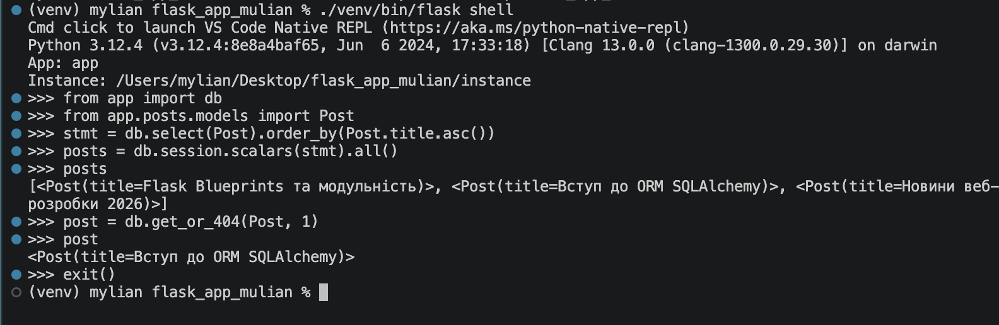

---

### 2. Виконання міграцій (Flask-Migrate / Alembic)

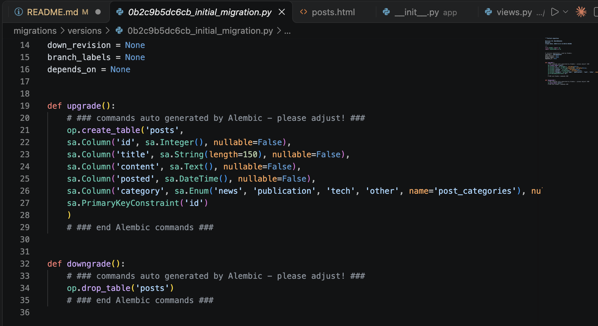

#### 2.2. Оновлення моделі та повторна міграція (`add is_active, author`)

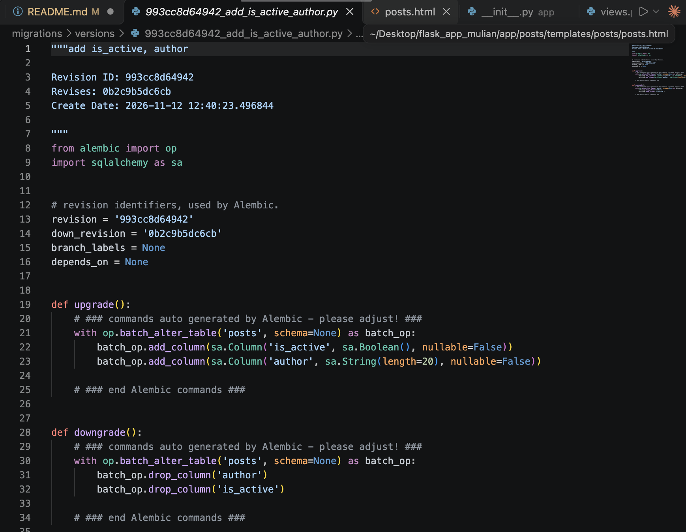

#### 2.3. Структура створеної бази даних (`instance/data.sqlite`)

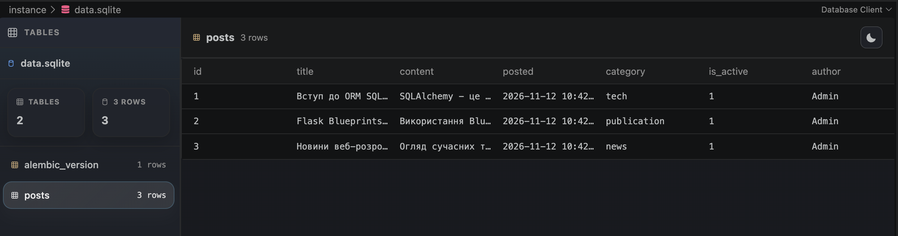

---

### 3. Інтерфейс користувача та тестування CRUD-операцій

#### 3.1. Відображення списку всіх постів (`GET /post`)

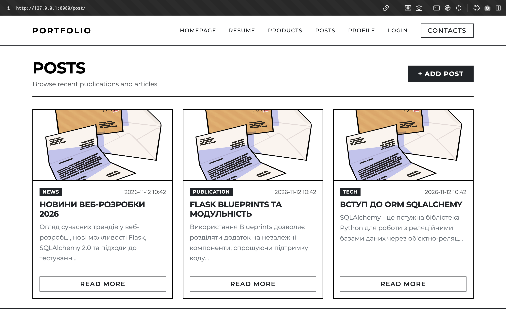

#### 3.2. Додавання нового поста (`GET / POST /post/create`)

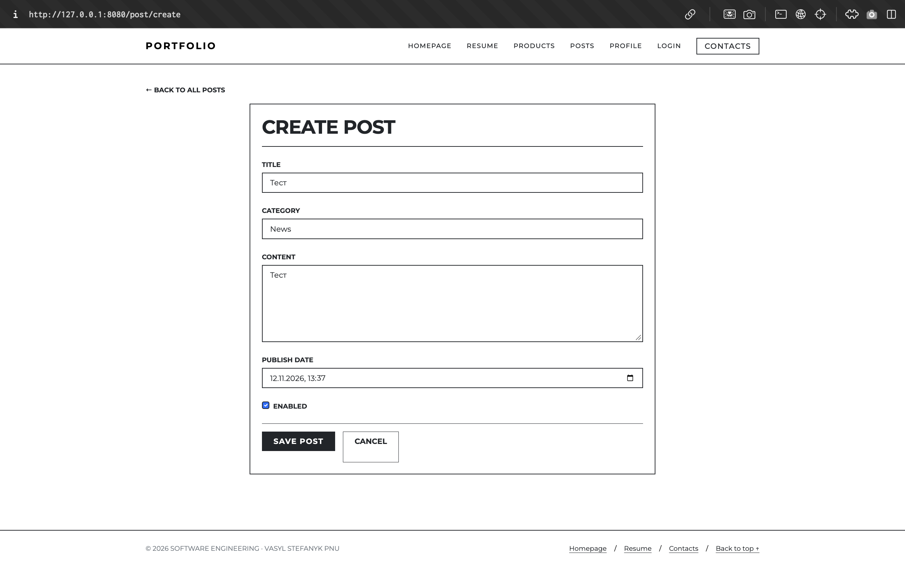

#### 3.3. Перегляд окремого поста (`GET /post/<id>`)

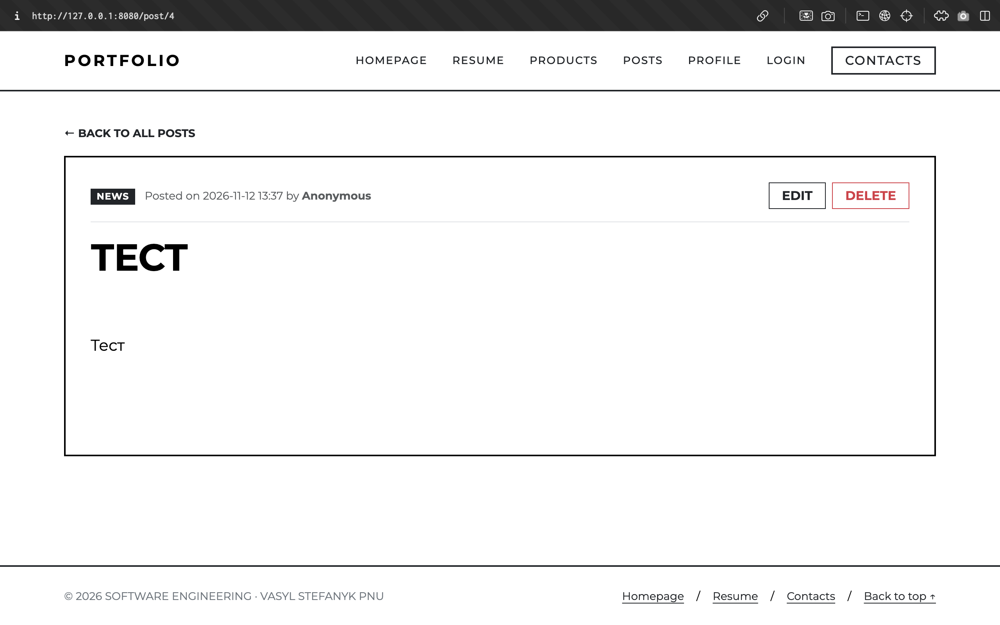

#### 3.4. Редагування поста (`GET / POST /post/<id>/update`)

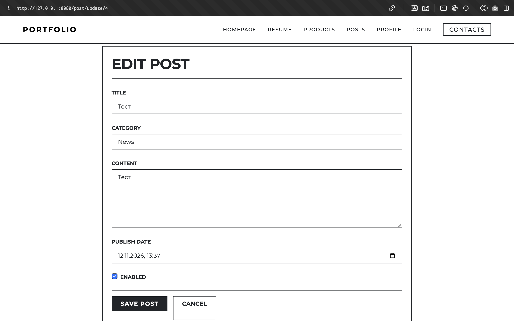

#### 3.5. Підтвердження та видалення поста (`GET / POST /post/<id>/delete`)

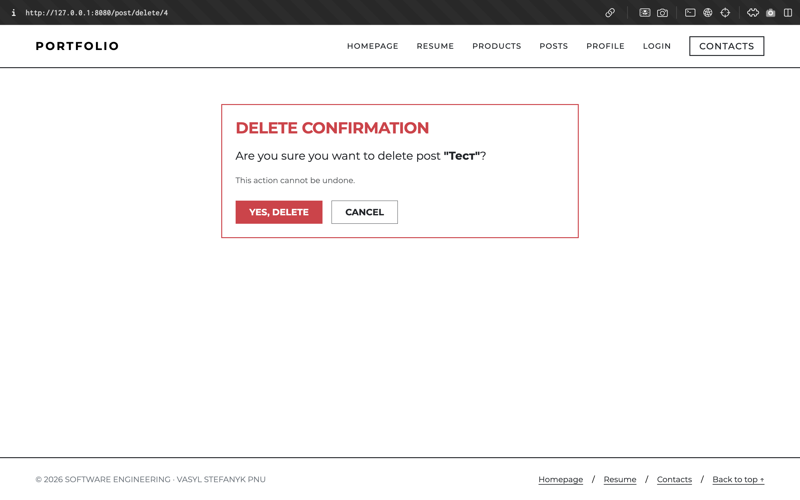

#### 3.6. Flash-повідомлення після операцій

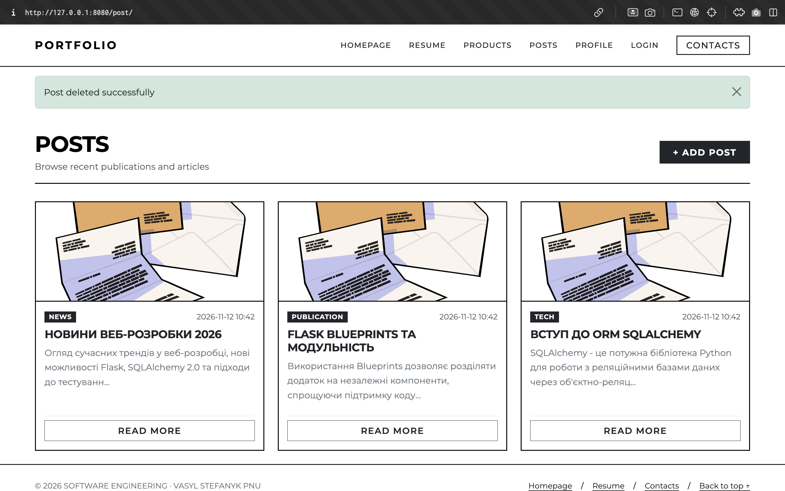

#### 3.7. Обробка помилки 404 (`GET /post/99999`)

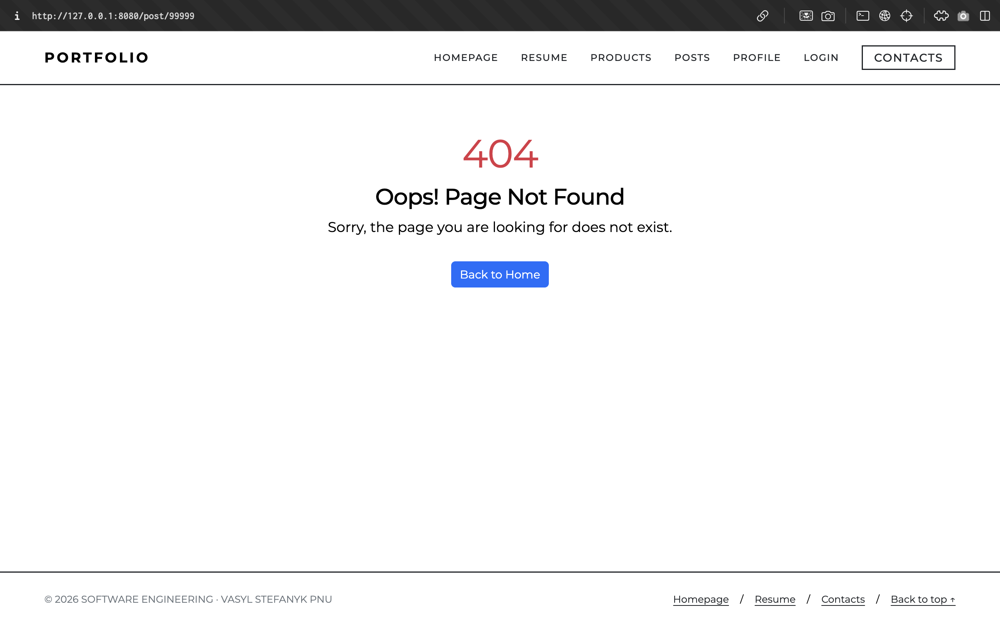

---

### 4. Модульні тести

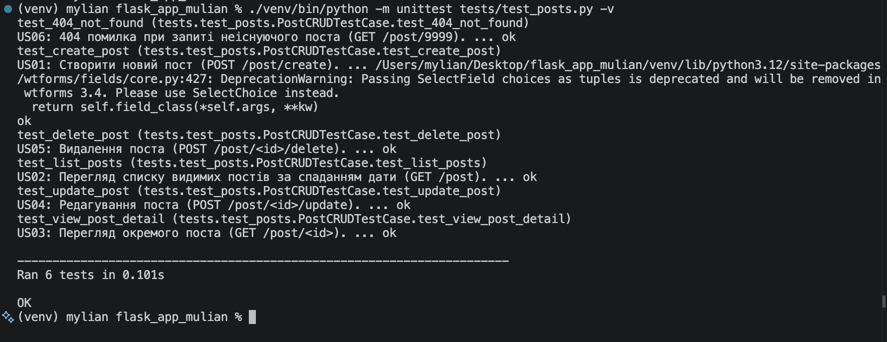
