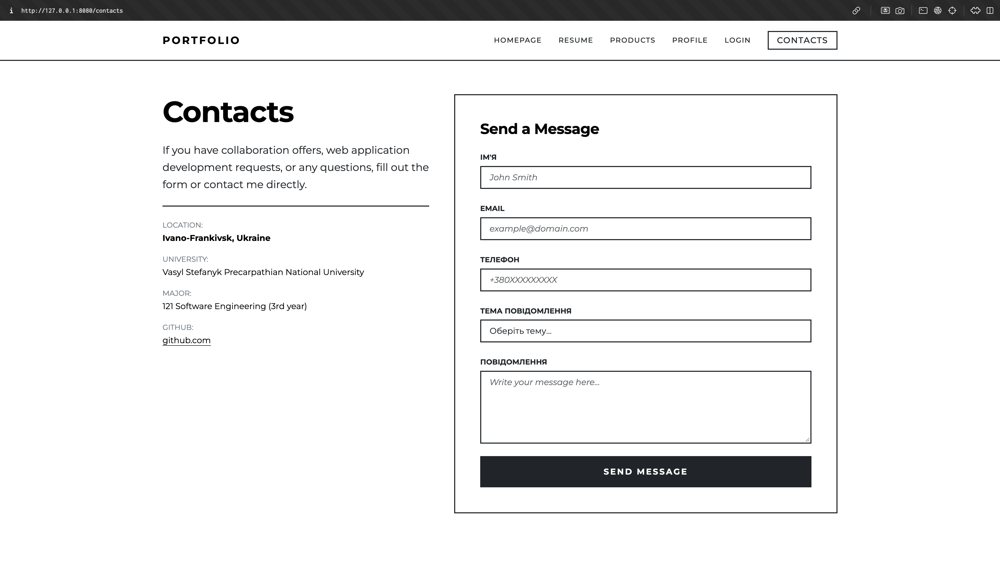
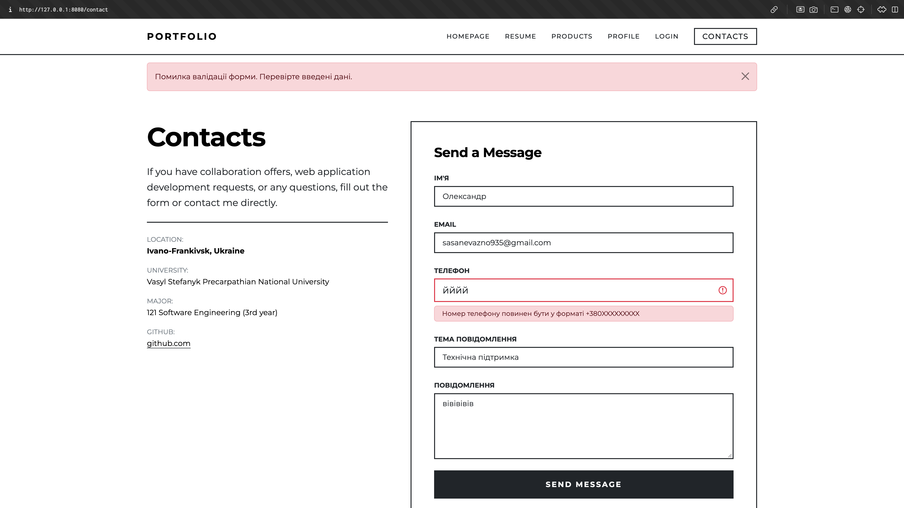
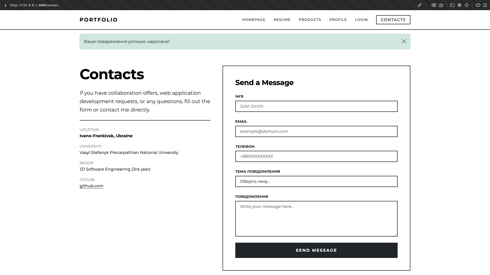
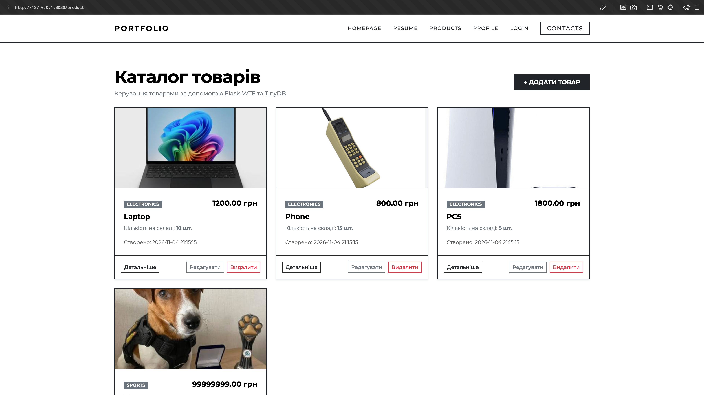
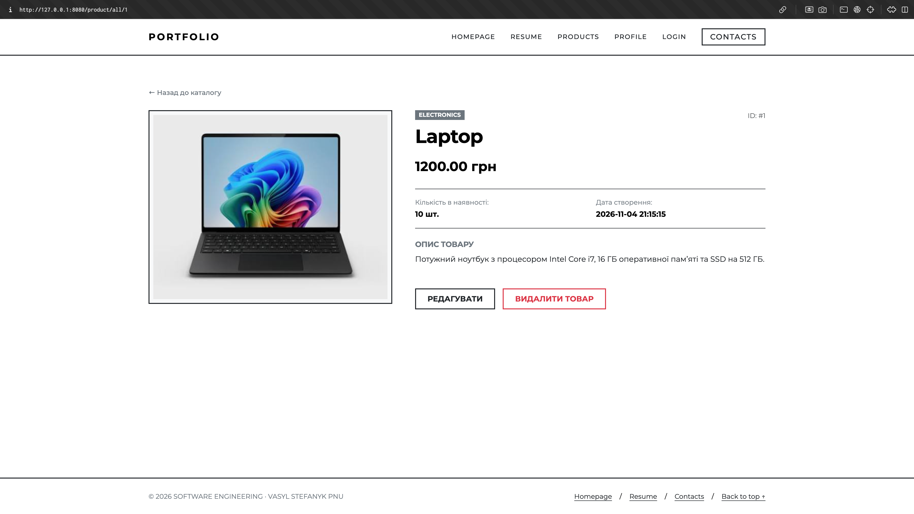
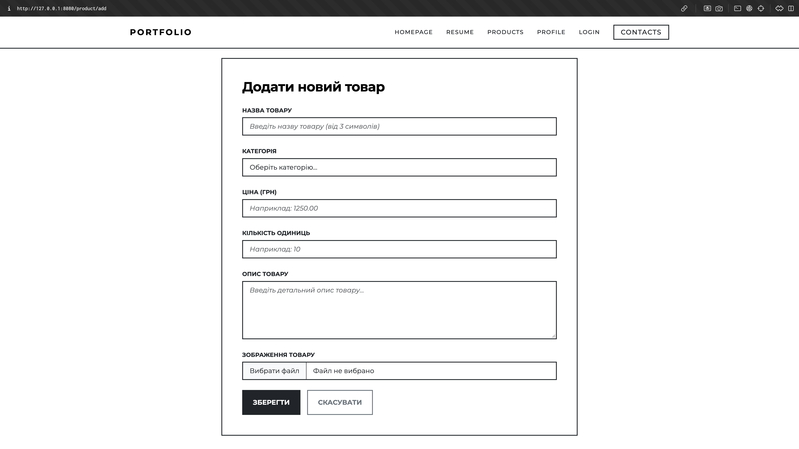
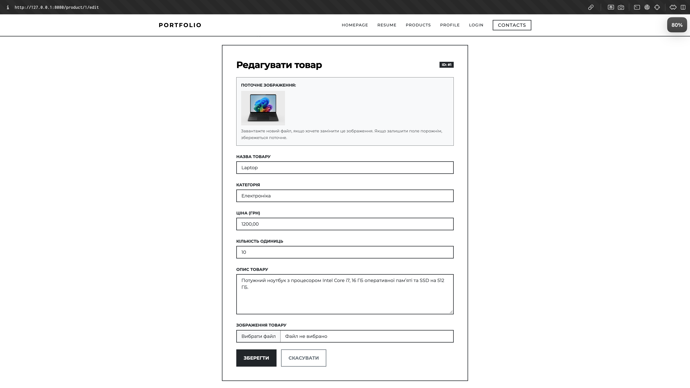
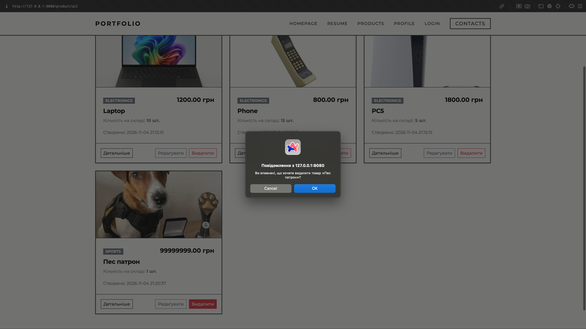
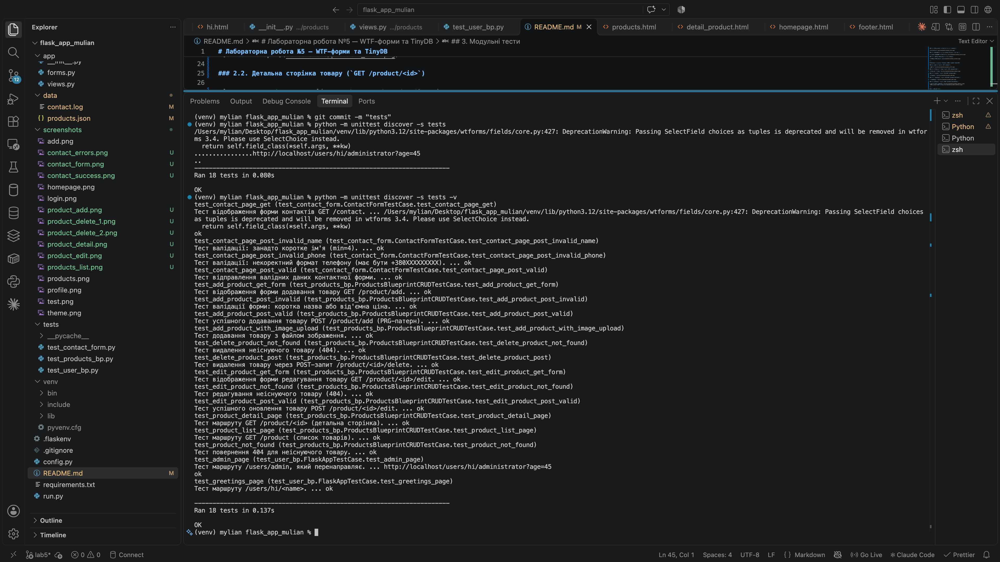

# Лабораторна робота №5 — WTF-форми та TinyDB

## Завдання 1. Контактна форма (Flask-WTF)

### 1.1. Відображення контактної форми (`/contact`)

### 1.2. Валідація форми та виведення помилок через макрос

### 1.3. Успішна відправка форми та логування

---

## Завдання 2. Блюпринт Products (CRUD, TinyDB, Flask-WTF)

### 2.1. Список товарів (`GET /product`)

### 2.2. Детальна сторінка товару (`GET /product/<id>`)

### 2.3. Додавання товару (`GET/POST /product/add`)

### 2.4. Редагування товару (`GET/POST /product/<id>/edit`)

### 2.5. Видалення товару (`POST /product/<id>/delete`)

---

## 3. Модульні тести

