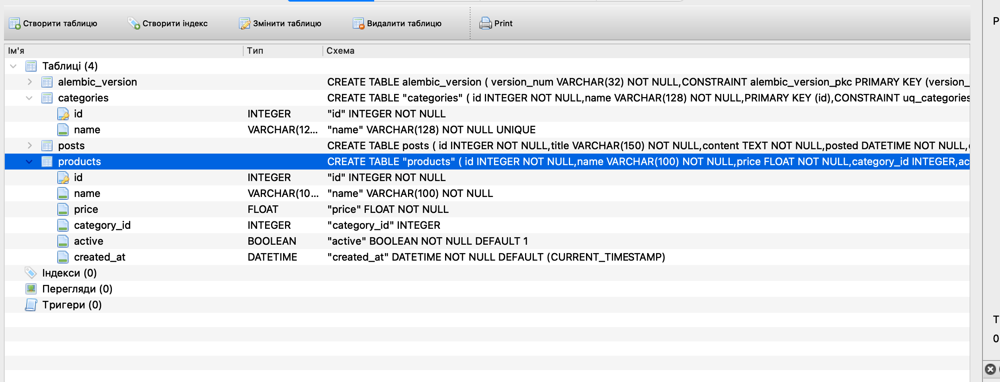
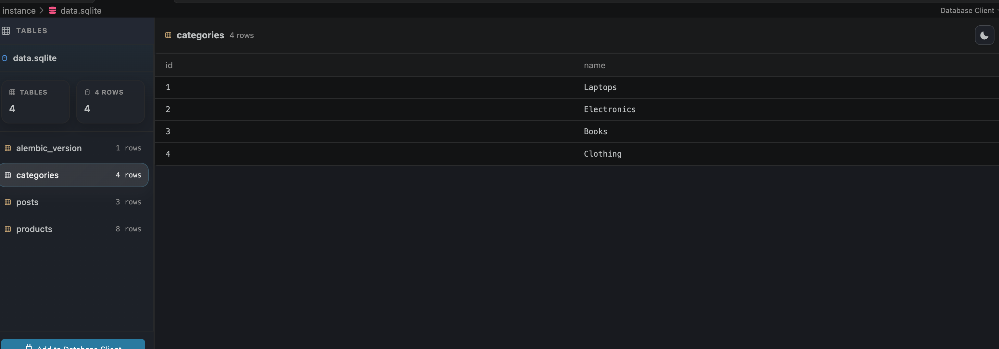
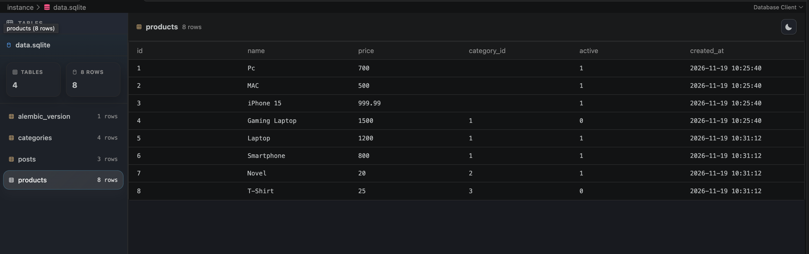
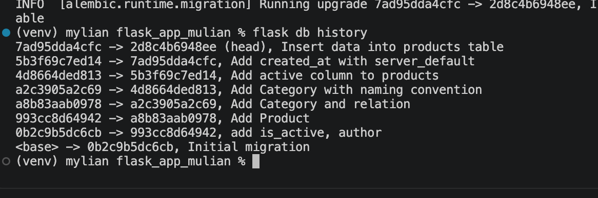

# Лабораторна робота №7 — Зв'язки. Міграції

### 1. Остаточна схема таблиць у базі даних (`products`, `categories`)

#### 1.1. Схема та зв'язки таблиць

### 2. Дані в таблицях бази даних

#### 2.1. Вміст таблиці `categories`

#### 2.2. Вміст таблиці `products`

---

### 3. Історія міграцій

