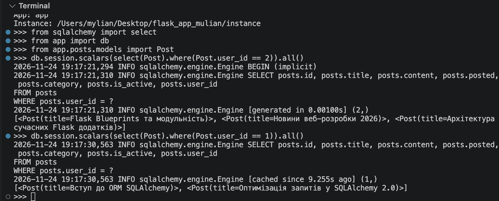
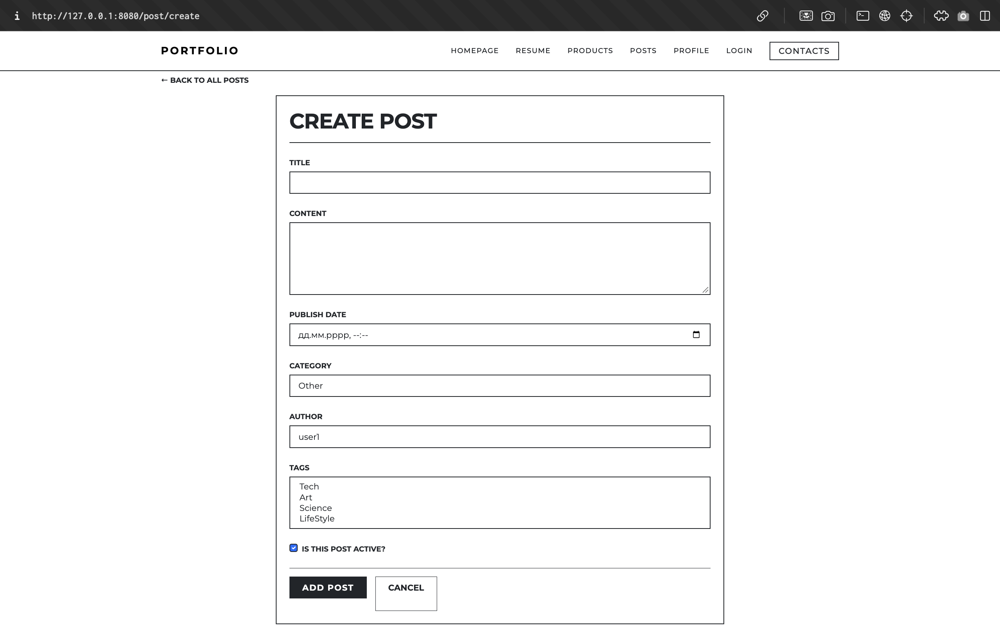
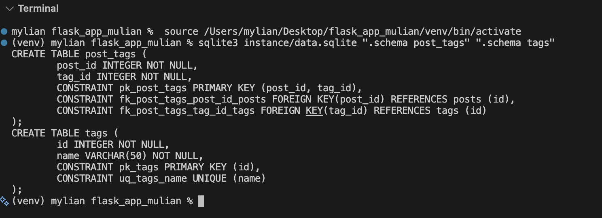
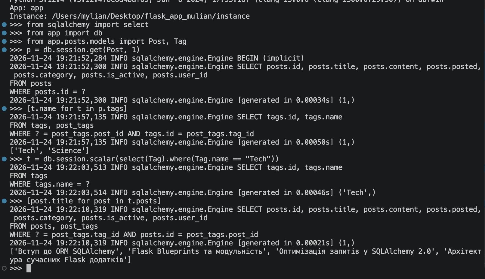
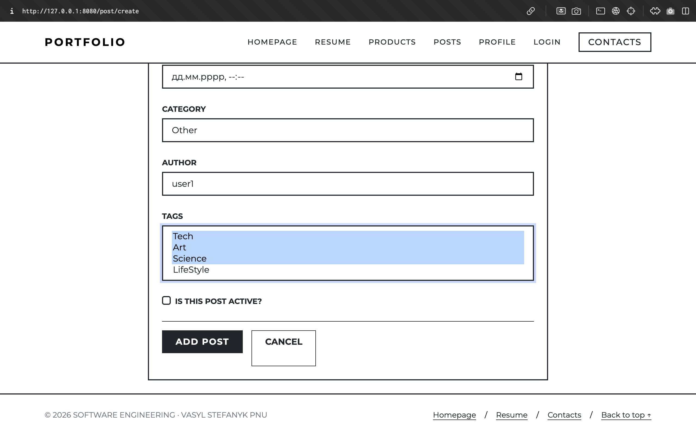
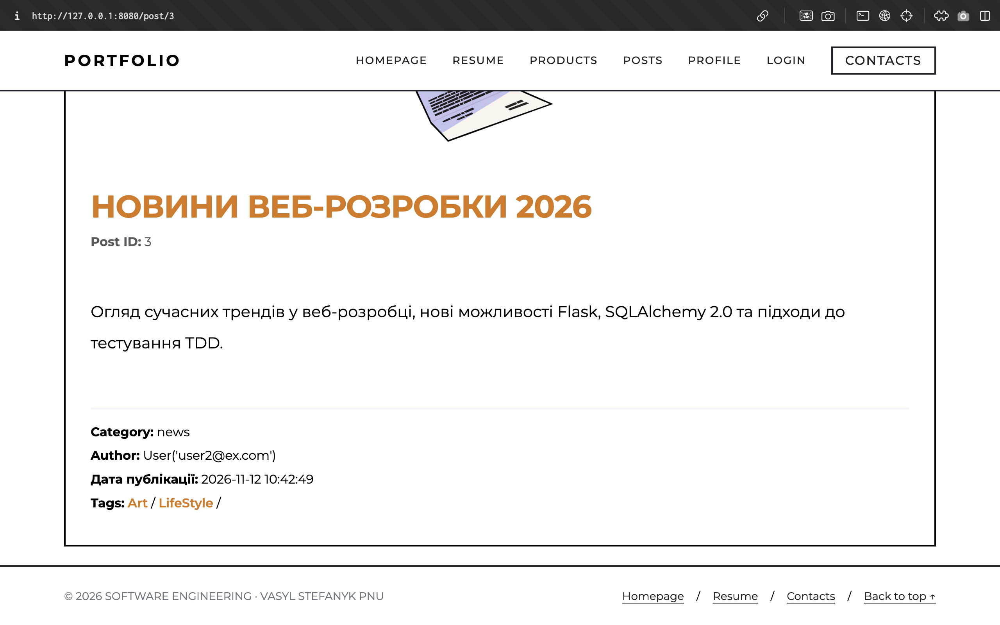
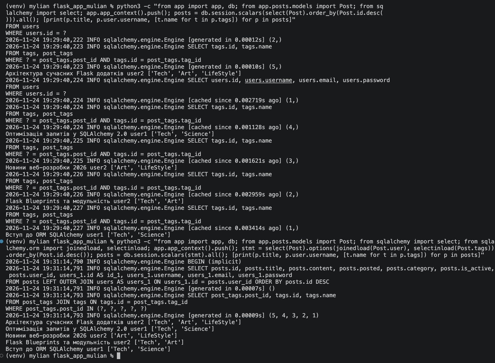

# Лабораторна робота №8 — Побудова зв'язків.

### 1. Виведення всіх постів користувача із `id=2` та `id=1` (Пункт 7)

---

### 2. Список вибору авторів з БД у формі додавання поста (Пункт 8)

---

### 3. Реалізація зв'язку Many-to-Many між `Post` та `Tag` (Пункт 9)

---

### 4. Додавання тегів через метод `append()` та запити вибірки (Пункт 10)

---

### 5. Вибір декількох тегів у формі додавання поста (Пункт 11)

---

### 6. Вивід та стилізація тегів на сторінці поста (Пункт 12)

---

### 7. Оптимізація завантаження авторів і тегів дописів (Пункт 13)

#### Порівняння результатів

| Варіант запиту                            | Кількість дописів | Кількість SELECT |
| :---------------------------------------- | :---------------: | :--------------: |
| **Без `.options()`**                      |         5         |      **8**       |
| **Із `joinedload()` та `selectinload()`** |         5         |      **2**       |
