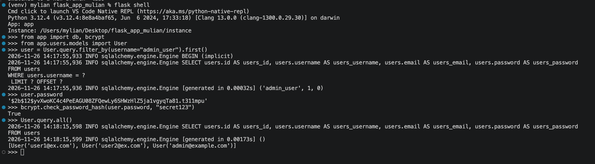
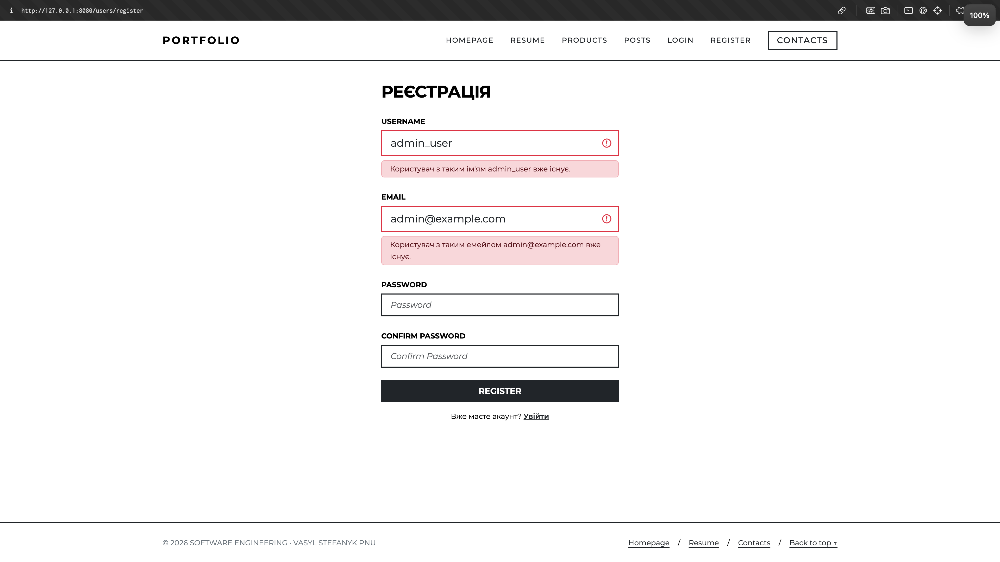
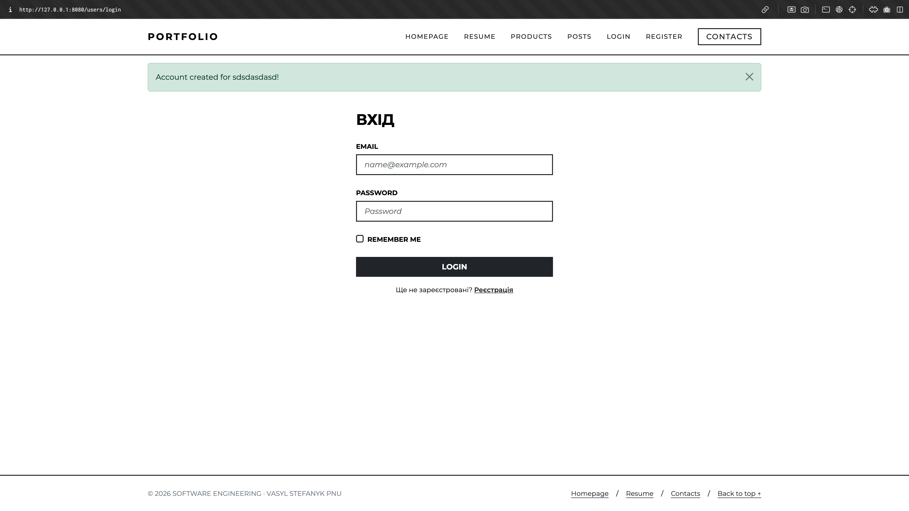
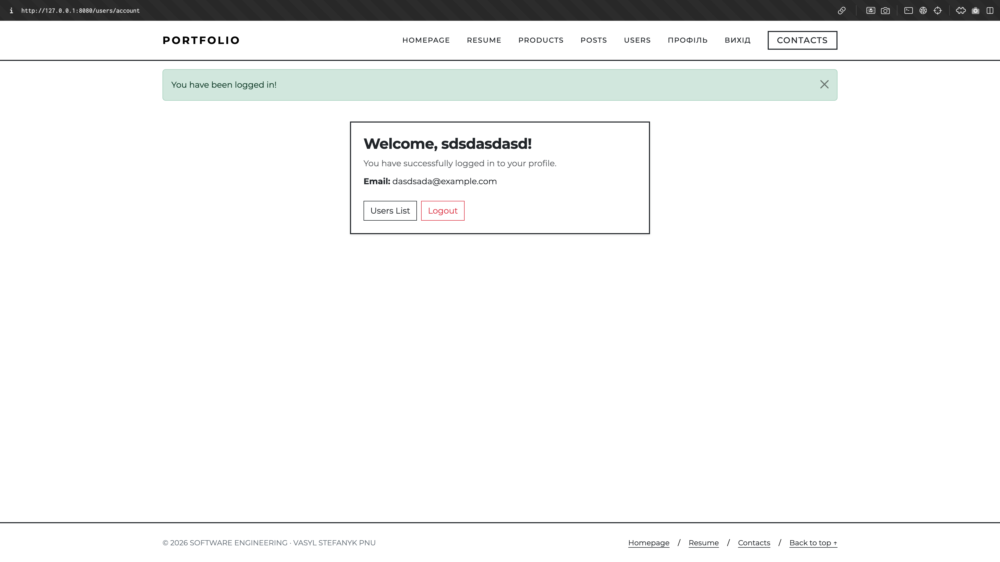
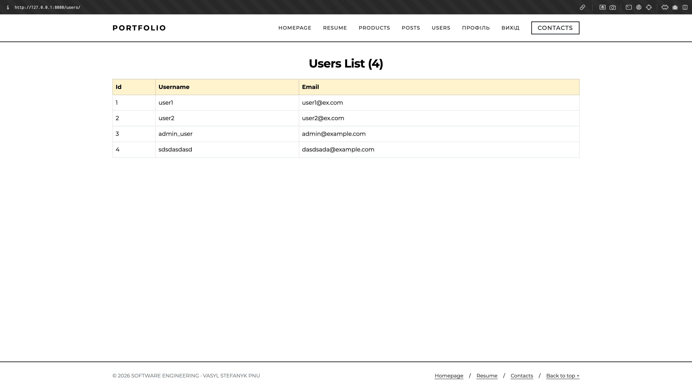
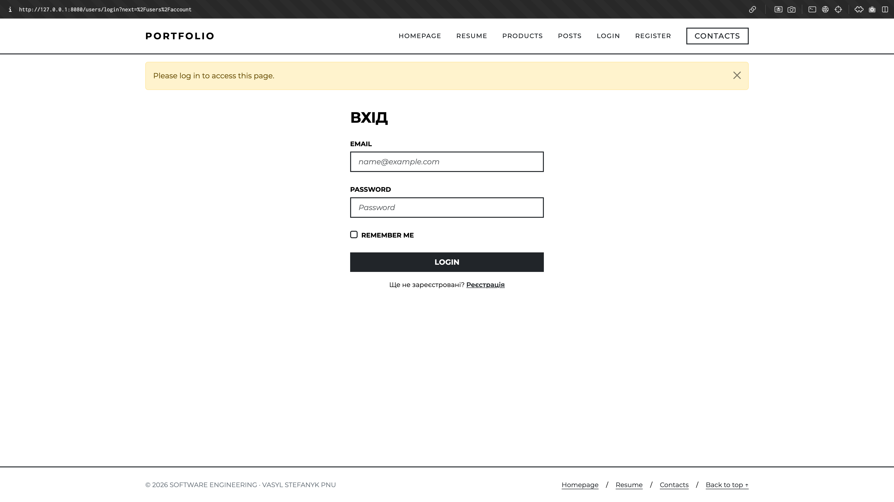
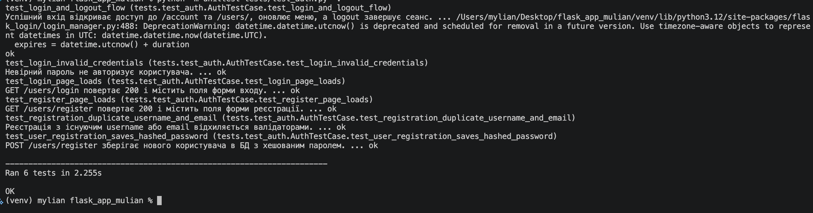

# Лабораторна робота №9 — Побудова системи реєстрації та входу користувачів. Модуль Flask-Login

### 1. Створення користувача з хешованим паролем у `flask shell` та перевірка хешу (Пункт 2)

---

### 2. Форма реєстрації з помилками валідації / вже існуючим користувачем (Пункт 3)

---

### 3. Успішна реєстрація користувача та збереження в БД (Пункт 3)

---

### 4. Вхід на сайт із перевіркою хешу пароля та сторінка профілю `/users/account` (Пункт 4)

---

### 5. Список усіх зареєстрованих користувачів `/users/` (Пункт 5)

---

### 6. Захист сторінок через `@login_required` та зміна меню після авторизації (Пункти 6–7)

---

### 7. Результати виконання тестів `tests/test_auth.py` (Пункт 8)

